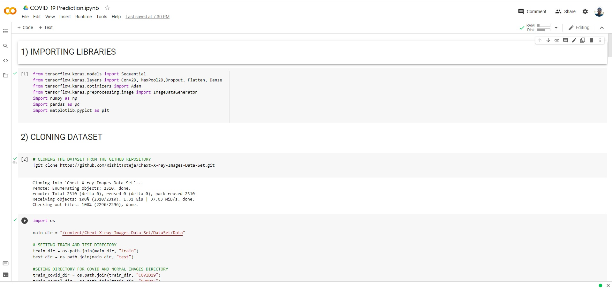
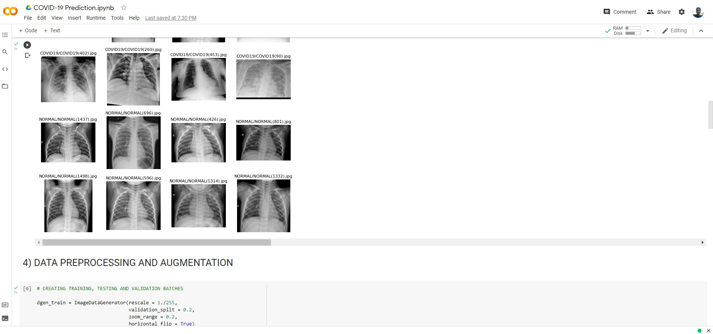
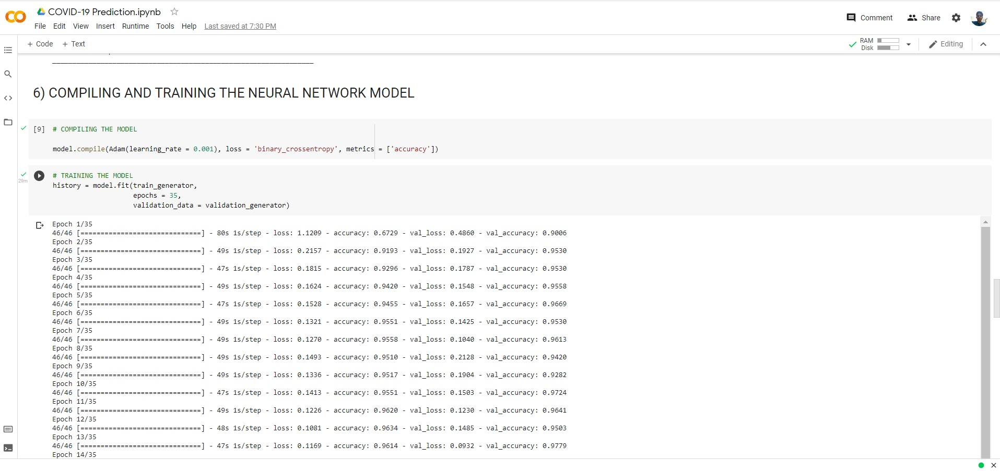
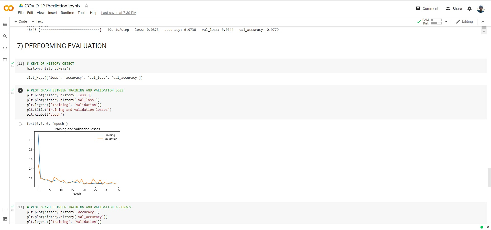
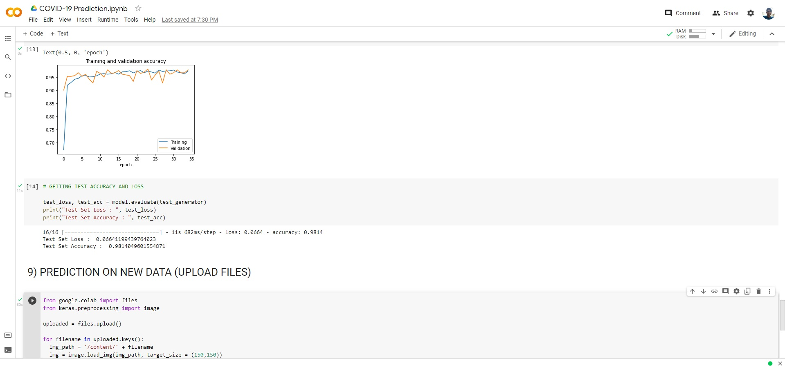

# COVID-19 Prediction from Chest X-rays (CNN)

A convolutional neural network, built from scratch in Keras/TensorFlow, that classifies a chest X-ray as COVID-19 positive or normal.

Originally a single Colab notebook (kept in `legacy/`), split up here into a small package so training/prediction can be run from the command line.

## How it works

The dataset has two classes of chest X-ray images — `COVID19` and `NORMAL` — already split into `train/` and `test/` folders. Images are loaded with Keras' `ImageDataGenerator`, rescaled to `[0, 1]`, and lightly augmented (zoom + horizontal flip) during training to reduce overfitting on a fairly small image set.

The model itself is a plain sequential CNN:

```
Conv2D(32) -> MaxPool -> Dropout
Conv2D(64) -> MaxPool -> Dropout
Flatten -> Dense(256, relu) -> Dropout -> Dense(1, sigmoid)
```

trained with the Adam optimizer and binary cross-entropy loss, since this is a two-class (COVID / normal) problem with a single sigmoid output.

## Layout

```
covidcnn/
├── data.py      - train/val/test ImageDataGenerators
├── model.py     - the CNN architecture
├── train.py     - training CLI
└── predict.py   - run a saved model on new images
tests/           - a couple of unit tests for the model
images/          - screenshots from the original notebook run
legacy/          - original notebook/script
```

## Setup

```bash
git clone https://github.com/rahulkr3101/COVID19-Xray-CNN.git
cd COVID19-Xray-CNN
pip install -r requirements.txt
```

## Dataset

The dataset is bundled in this repo under `DataSet/`, laid out as:

```
DataSet/Data/
├── train/
│   ├── COVID19/
│   └── NORMAL/
└── test/
    ├── COVID19/
    └── NORMAL/
```

## Training

```bash
python -m covidcnn.train --data-dir DataSet/Data --epochs 35 --model-out model.h5 --history-csv history.csv
```

This builds the generators, trains the CNN, evaluates it on the held-out test set, and saves the trained model to `--model-out`.

## Predicting on new X-rays

```bash
python -m covidcnn.predict --model model.h5 path/to/xray.jpg
```

Prints whether each image looks COVID-19 positive or normal, along with the raw sigmoid score (closer to 0 = more confidently COVID-19, closer to 1 = more confidently normal).

## Changes from the original notebook

- Split the one-shot Colab script into `data.py` / `model.py` / `train.py` / `predict.py`.
- CLI args (`--epochs`, `--batch-size`, `--learning-rate`, `--dropout`, etc.) instead of hardcoded values.
- Dropped the Colab-only bits (`!git clone`, `google.colab.files.upload()`) in favor of a normal `--data-dir`/`--model`/image-path argument style that works outside a notebook.
- `train.py` can optionally dump per-epoch loss/accuracy to a CSV instead of only plotting in-notebook.
- A couple of unit tests on the model architecture (output shape, loss type).

## Results

From the original training run (35 epochs):

| Set | Accuracy | Loss |
|---|---|---|
| Training | 97.38% | 0.0875 |
| Validation | 97.79% | 0.0744 |
| Test | 98.14% | 0.0664 |







## Possible next steps

- Try transfer learning (e.g. a pretrained ResNet/EfficientNet backbone) and compare against this from-scratch CNN.
- Add a confusion matrix / precision-recall breakdown instead of just accuracy, since class imbalance can make accuracy alone misleading for a medical screening task.
- k-fold cross-validation instead of a single train/val/test split, given the dataset size.
- Grad-CAM visualization to sanity-check the model is actually looking at lung regions rather than image artifacts.

## Testing

```bash
pip install -r requirements-dev.txt
pytest
```

## References

1. [Chest X-ray dataset](https://github.com/RishitToteja/Chext-X-ray-Images-Data-Set)
2. [Original Colab notebook](https://colab.research.google.com/drive/1oeA2Rp5B_8VWtOXEoY7R4dQMaO4pZe_y)

## Disclaimer

This is a learning/research project, not a diagnostic tool. It should not be used to make real medical decisions.
